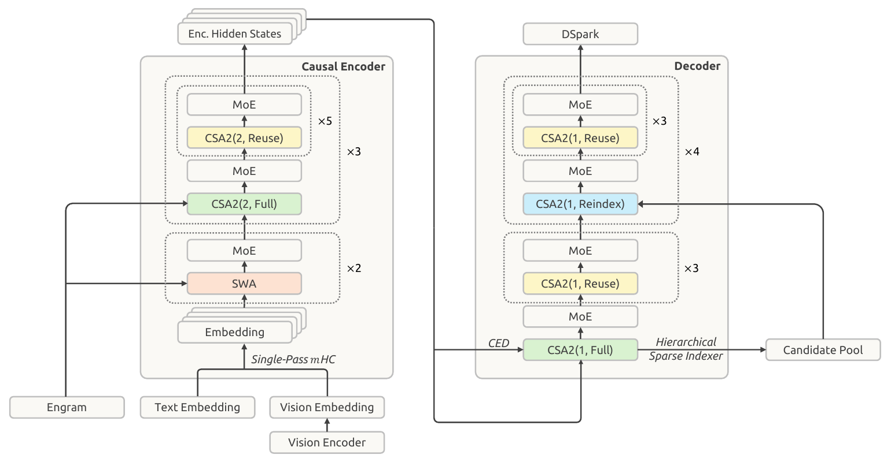
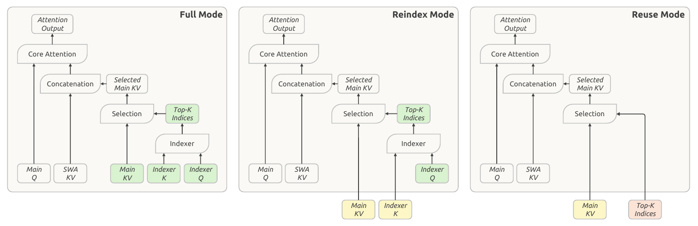
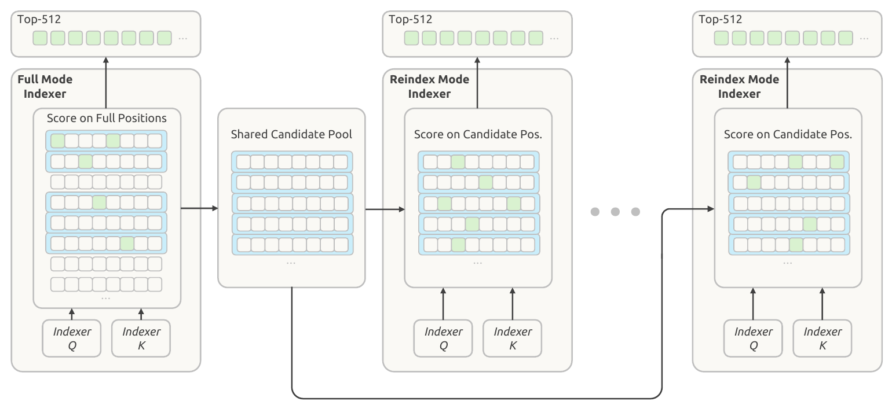
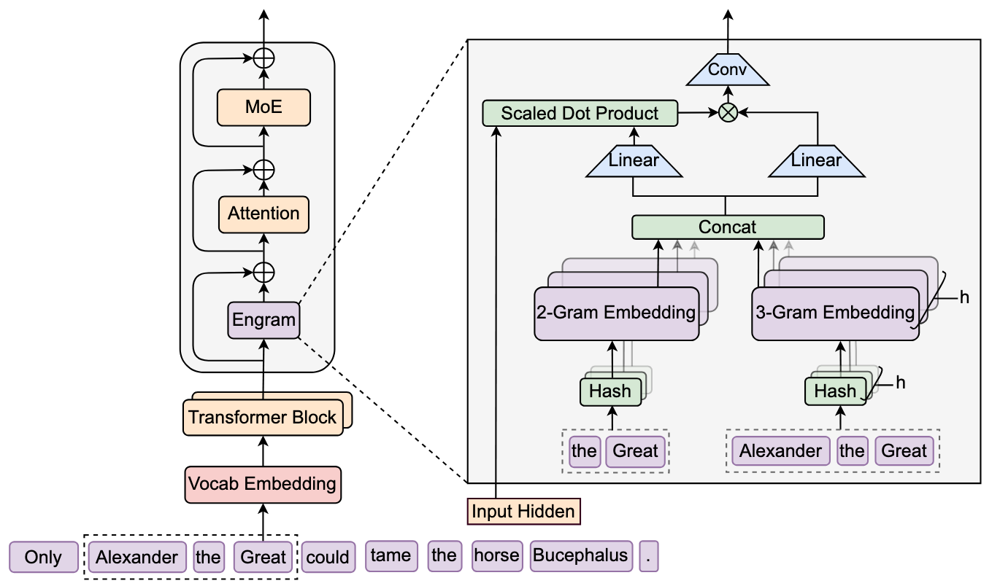
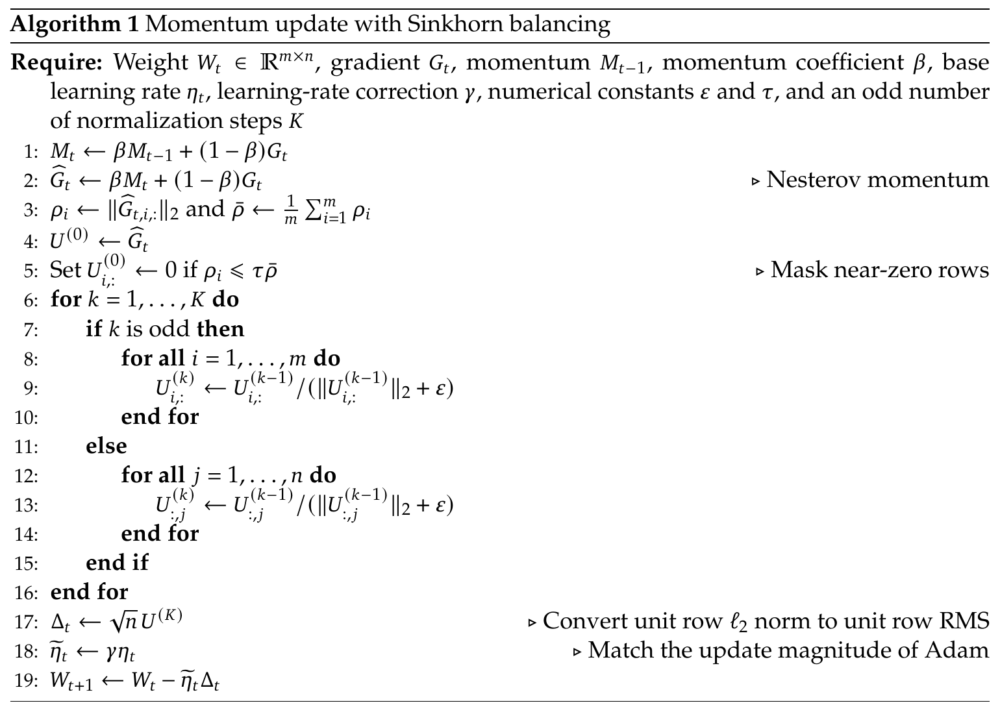
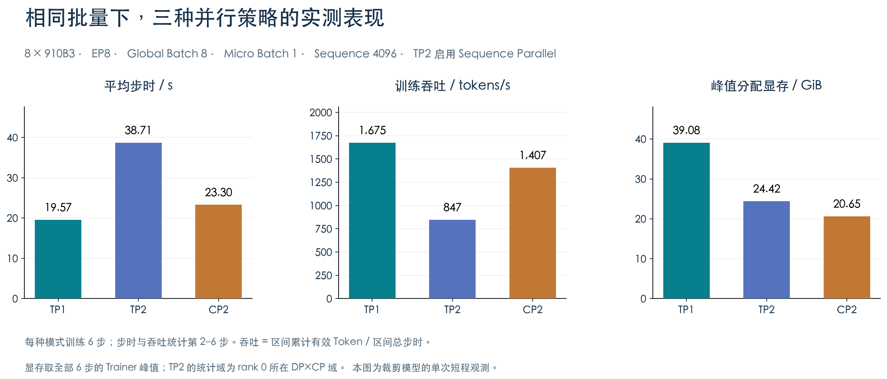
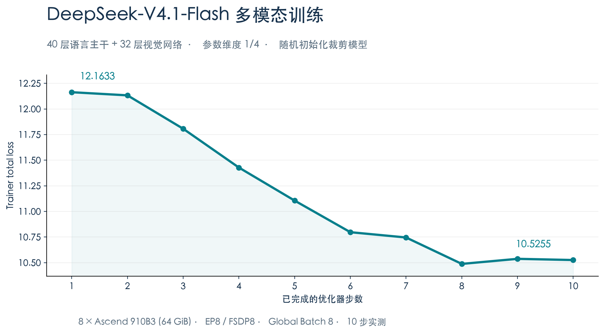
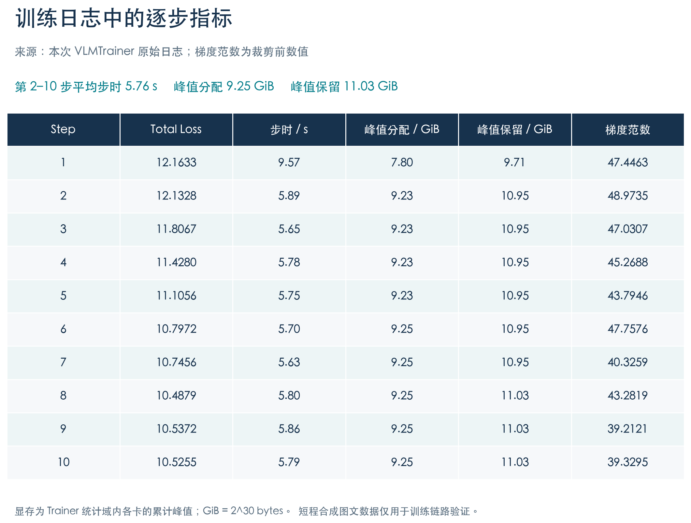

# HyperParallel 基于昇腾支持 DeepSeek-V4.1-Flash 训练：拥抱前沿模型架构，释放昇腾大模型训练潜能

## 一、前言：DeepSeek-V4.1-Flash 发布，大模型训练迎来新挑战

随着大模型加速向长上下文、多模态与智能体应用演进，模型能力的提升不再仅仅依赖参数规模的增长，如何在有限的计算、存储和通信资源下实现更高效的训练与推理，正成为技术创新的重要方向。

2026 年 9 月，DeepSeek 正式发布 **DeepSeek-V4.1-Flash**。作为新一代多模态 MoE 模型，其拥有 **552B 骨干参数**，支持最长 **1M Tokens** 的上下文，并通过一系列架构与优化算法创新，实现了模型能力与计算效率的双重突破。

与上一代模型相比，DeepSeek-V4.1-Flash 引入了 Causal Encoder-Decoder（CED）非对称架构、Compressed Sparse Attention 2（CSA2）、Engram 条件记忆模块、Single-Pass mHC 等技术，并采用 Head-wise Muon 和 Sinkhorn Balancing 等优化方法，进一步探索大规模模型的高效训练路径。

这些创新提升了模型效率，也对训练框架提出了新的要求：如何支持跨层参数与计算状态共享？如何高效管理超大规模稀疏参数？如何将新型优化器与分布式训练结合？如何兼顾多模态、MoE 与长序列场景下的计算和通信效率？

**HyperParallel 是面向昇腾超节点的分布式并行加速框架**，以模型与系统优化解耦为设计理念，提供 FSDP、TP、CP、EP、PP 等并行能力，以及混合精度、重计算、异构内存管理与优化器等训练组件。

面向 DeepSeek-V4.1-Flash 的新架构与新需求，HyperParallel 开展模型训练适配，依托可组合的分布式并行能力和模块化系统设计，探索前沿模型在昇腾算力平台上的高效训练实践。

## 二、聚焦模型技术创新，HyperParallel 面向昇腾超节点构建高效训练支撑

DeepSeek-V4.1-Flash 的新设计，对训练框架提出的不只是新增模型层的要求，还涉及跨层状态传递、参数分片、激活重计算、稀疏数据访问、优化器更新和设备算子的协同。面向这些挑战，HyperParallel 在已有 TP、CP、EP、FSDP 等基础能力之上，围绕六项核心技术开展适配，并结合昇腾软件栈中可复用的高性能算子，逐步打通从模型结构到分布式训练的完整链路。

### 1. Causal Encoder-Decoder：非对称架构，提升计算效率

DeepSeek-V4.1-Flash 的重要创新之一，是采用 Causal Encoder-Decoder（CED）架构，将输入处理与输出生成划分为不同的计算路径。

传统 Decoder-only 模型在输入预填充与输出解码阶段通常使用相同的模型计算路径，而 CED 允许输入 Token 经过较轻量的 Encoder 路径处理，再通过 Decoder 完成输出生成。

得益于这一设计，DeepSeek-V4.1-Flash 在 Prefill 阶段每 Token 仅激活约 **8B 参数**，Decode 阶段激活约 **16B 参数**，显著降低了长输入场景的计算开销。



CED 及其共享注意力结构使模型各层不再拥有完全相同的计算与状态依赖。HyperParallel 在模型实现中依据配置确定不同层的压缩率、共享 KV 来源和索引来源，将共享状态贯穿层间前向计算，并为参数分片、FSDP 包装与激活重计算保留明确的模块边界。注意力投影、共享 KV 投影和 Indexer 等参数也按照各自计算角色采用对应的布局策略。

### 2. CSA2：跨层 KV 共享，挑战传统注意力计算模式

在长上下文场景下，Attention 的计算、状态保存与通信是影响模型效率的重要因素。

DeepSeek-V4.1-Flash 提出了 **Compressed Sparse Attention 2（CSA2）**，通过跨层共享 Global KV Cache 和稀疏索引，减少注意力状态的重复存储。

CSA2 包含三种工作模式：

- **Full**：计算并生成全局 KV，同时执行稀疏索引。
- **Reindex**：复用已有全局 KV，重新计算 Top-K 稀疏索引。
- **Reuse**：同时复用全局 KV 与 Top-K 索引，直接执行稀疏注意力计算。

CSA2 结合 FP4 KV Cache，使模型的全局 KV Cache 占用降低至约 **890 Bytes/Token**，约为 DeepSeek-V4-Flash 的四分之一。






针对 CSA2 的跨层数据依赖，HyperParallel 建立共享状态管理机制，区分压缩 KV、Indexer Key、候选块与 Top-K 结果的生产和复用关系，保留分层候选选择及 Indexer 辅助训练目标。在 TP 场景下，框架协调局部注意力计算与跨分片结果汇总；在 CP 场景下，通过可微通信组织共享 KV、索引相关状态的跨卡访问，并将通信发起与等待过程分离，为计算与通信协同创造条件。

跨层共享还给激活重计算带来挑战：多个后续层可能依赖前面某层生成的同一份状态。对此，HyperParallel 实现**感知 Full、Reindex、Reuse 层角色的选择性重计算策略**，在保证前向选区与反向依赖一致的同时，避免重计算重复发布共享状态。

HyperParallel 通过 `omni_training_custom_ops` 注册的 `torch.ops.custom.npu_sparse_flash_attention_enhance` 接入昇腾稀疏 Attention 前反向计算，并完成 Scalar Sink 等训练语义的张量组织与梯度接线。后续HyperParallel 将在进一步的融合优化中对接 **CANN 提供的 Lightning Indexer V2、Sparse Flash MLA 前反向和 Indexer KL 梯度融合算子**。

### 3. Engram：超大规模条件记忆，探索高效参数管理

DeepSeek-V4.1-Flash 引入 **Engram 条件记忆模块**，通过基于 N-gram 的确定性哈希索引与稀疏查表机制，将部分知识记忆与 Transformer 主干计算解耦。

模型采用两个 Engram 模块，合计引入约 **196B 条件记忆参数**。

这一设计有助于提升模型能力，但超大规模 Embedding Table 也对训练系统的参数存储、数据访问及优化器状态管理提出了更高要求。



在模型语义上，HyperParallel 实现 N-gram 哈希映射与查表，处理跨文档边界和图像 Token Mask，避免不符合语义的记忆索引。在并行训练中，Engram Embedding 可沿 EP 维度按行分片：查询请求路由至参数所属设备，查表结果回填原始 Token 位置，反向梯度再按参数所有权回传，无须每次聚合完整参数表。

针对更大规模的稀疏记忆，HyperParallel 进一步提供 **CPU 常驻 Engram 参数表**方案。参数行保存在主机内存中，查表时先去重并仅搬运命中行，反向阶段聚合稀疏梯度，在 CPU 侧执行 SparseAdam 更新，同时支持配套的参数和优化器状态保存与恢复。


### 4. Head-wise Muon 与 Sinkhorn：面向参数结构的新型优化器

DeepSeek-V4.1-Flash 在优化器设计方面也进行了针对性改进。

**Head-wise Muon**

传统 Muon 对整个权重矩阵执行更新变换，而 Head-wise Muon 将 Query、Key 等注意力权重按照 Attention Head 进行划分，再对不同 Head 分别应用 Muon 更新。

这种方式能够根据不同注意力头的梯度特征进行独立预条件化，更好地适应不同 Head 之间的异质性。

**Sinkhorn Balancing**

对于 Engram Embedding、Token Embedding 和 Prediction Head 等大规模矩阵，DeepSeek-V4.1-Flash 使用 Momentum + Sinkhorn Balancing 替代 Adam 类优化方式。

该方法通过迭代行、列归一化，平衡更新矩阵在不同维度上的尺度，并且只需维护动量缓冲区，有助于减少超大规模参数的优化器状态开销。




### 5. Single-Pass mHC：高效残差连接，简化计算路径

DeepSeek-V4.1-Flash 在 mHC（Manifold-Constrained Hyper-Connections）基础上引入 **Single-Pass mHC**。

该技术重新组织多路残差流的更新过程，将原本分散的残差更新、输入混合和系数预测整合到更高效的计算路径中。

配合 Mega-mHC 融合算子，模型推理阶段可以显著减少中间激活的数据读写开销。

在模型层，HyperParallel 适配跨子层的残差状态传递与延迟混合机制，处理前一子层的更新在下一计算边界完成的训练语义，并兼顾 Engram、模型输出等特殊边界。在设备执行层，框架进一步提供 **MegaMhc 训练前反向路径**：围绕 Token Tile 构建任务图、事件依赖和执行顺序，将混合、归一化、投影与 Sinkhorn 等操作组织为连续的计算流水。

**其中，基础数学计算复用 CANN 提供的 `MhcPost`、`MhcPreSinkhorn`、`RMSNorm` 等算子原语；HyperParallel 在此基础上完成 MegaKernel 任务调度、融合执行和反向传播接线。** 相关自定义算子通过 torch-npu 提供的 C++ 扩展及 ACLNN 桥接机制接入 PyTorch 训练计算图，并非由 torch-npu 内置接口独立实现整个 MegaMhc。

这一方案将成熟的设备算子能力与框架侧流水编排结合，为降低碎片化算子执行开销提供了实现路径。

### 6. 原生多模态 MoE：灵活组合并行策略，释放集群算力

DeepSeek-V4.1-Flash 从预训练阶段开始引入多模态数据，使用 DeepSeek-ViT 视觉编码器处理图像输入，并通过视觉投影模块与语言主干进行融合。

同时，模型延续细粒度 MoE 架构，并针对图像和文本 Token 分别维护专家负载均衡策略。

这种多模态与 MoE 相结合的结构，使得视觉计算、语言计算、专家通信以及长序列 Attention 需要在统一训练流程中协同执行。

针对模型的多模态架构，HyperParallel 完成了 DeepSeek-ViT 的 Patch Embedding、Attention、2D RoPE 与视觉投影适配，将视觉特征注入对应文本位置，并维护图像 Token 与 Engram 文本记忆之间的边界。在视觉并行方面，框架提供 **Encoder Parallel**，沿图像 Patch 序列切分计算，通过 Ulysses 布局转换与特征回传对接语言主干，同时为视觉模块设置独立的参数分片边界。

在 MoE 侧，HyperParallel 复用 EP 体系实现专家分片、Token Dispatch/Combine 及 Grouped GEMM 计算，并保留 V4.1 特有的 **FP32 Clipped SwiGLU** 计算语义，避免以普通 SwiGLU 替换后改变专家网络行为。

**专家矩阵计算直接复用 torch-npu 与 CANN 的现有能力。** HyperParallel 通过 `torch_npu.npu_grouped_matmul` 接口执行 Grouped GEMM 及相应反向计算，torch-npu/op-plugin 负责将接口桥接到 CANN GroupedMatmul 算子，由 CANN 提供底层设备计算实现。与此同时，当前 Grouped GEMM 路径中的 Clipped SwiGLU 仍保留 HyperParallel 的 FP32 计算逻辑，不能将整个专家 MLP 描述为单个已融合的 torch-npu 算子。

围绕进一步的融合与训练目标优化，HyperParallel 已接入部分 MegaGate 能力，并持续完善 MegaMoe 训练路径、动态专家工作量管理以及图像/文本分模态负载均衡更新。**其中部分功能仍处于开放 PR 阶段，是否启用取决于实际训练配置。**


**模型不断创新，并行框架也需要随之演进。** HyperParallel 希望通过模型实现与系统优化解耦，让新架构能够复用成熟的并行基础能力，降低前沿模型的适配和训练成本。

## 三、训练实践：从模型加载到分布式训练

在完成模型架构与核心训练组件支持后，HyperParallel 提供了 DeepSeek-V4.1-Flash 的端到端训练示例，覆盖**纯文本训练、多模态训练以及 TP、CP、EP、FSDP 等多种分布式并行能力**。

依托统一的 Trainer 训练接口、声明式 YAML 配置和模块化并行策略，用户无需在训练入口中手动编排复杂的并行逻辑，即可完成模型构建、组件替换、数据处理、分布式初始化和训练执行。

下面以本次实际验证使用的 **单机8卡 Ascend 910B3 NPU（单卡64 GiB HBM）** 环境为例，介绍 DeepSeek-V4.1-Flash 在 HyperParallel 上的训练流程。后文训练结果同样基于该8卡环境测试，Demo配置与实测配置保持一致。

### 1. 模型与环境准备

为便于快速验证新架构的训练能力，HyperParallel 提供了 DeepSeek-V4.1-Flash 的模型裁剪构建器 `build_cropped_deepseek_v41()`。

该构建器读取官方模型配置，在保留关键网络结构和层角色的基础上，对部分参数维度进行缩放，并通过 `HyperAutoModelForCausalLM.from_config()` 随机初始化模型。

当前训练示例支持纯文本和多模态两种场景：

| 配置项            | 纯文本训练            | 多模态训练            |
| -------------- | ---------------- | ---------------- |
| 语言模型层数         | 保留全部40层          | 保留全部40层          |
| 视觉模型层数         | —                | 保留全部32个视觉Block   |
| 文本参数维度缩放       | 1/8              | 1/4              |
| 视觉参数维度缩放       | —                | 1/4              |
| Routed Experts | 16               | 16               |
| 最大序列长度         | 4096             | 4096             |
| 实测设备           | 8 × Ascend 910B3 | 8 × Ascend 910B3 |

参数维度缩放主要作用于模型宽度、Head数量、低秩维度等参数规格，并不意味着模型总参数量严格按相同比例缩减。模型仍保留主干深度及指定层的功能角色，以便在较小资源规模下验证 CSA2、Engram、mHC、MoE 等核心模块的训练流程。

需要说明的是，**本示例从官方配置构建并随机初始化裁剪模型，并非加载完整552B骨干参数的预训练权重**。当前实验主要用于验证模型结构、分布式训练链路及资源开销，完整规模模型训练仍需进一步进行资源配置、精度及稳定性验证。

首先获取 HyperParallel 源码并配置昇腾训练环境：

```bash
git clone https://github.com/mindspore-ai/hyper-parallel.git
cd hyper-parallel

source /path/to/Ascend/cann/set_env.sh
python -m pip install -e .
```

随后准备 DeepSeek-V4.1-Flash 官方模型配置和Tokenizer，并设置本地模型路径：

```bash
export DSV41_MODEL_DIR=/path/to/DeepSeek-V4.1-Flash
export PYTHON_BIN=python
export NPROC_PER_NODE=8
```

本次实测环境使用 Ascend 910B3 NPU、CANN 9.1.0、PyTorch 2.9.0、torch-npu 2.9.0.post6 和 Transformers 5.13.0，并安装与环境匹配的 `omni_training_custom_ops`，用于支持增强稀疏 Attention 等相关算子。

### 2. 纯文本训练：支持 TP、CP 等多种并行配置

HyperParallel 提供了统一的 DeepSeek-V4.1-Flash 纯文本训练入口，可通过不同运行模式快速切换 TP、CP 等并行策略。

本次实验使用8卡 Ascend 910B3，将 Global Batch Size 设置为8、Micro Batch Size设置为1，并根据不同并行策略调整EP及FSDP分片配置。

首先启动TP1基础训练：

```bash
NPROC_PER_NODE=8 bash \
  examples/training_demo/deepseek_v41/run_deepseek_v41_online.sh \
  "$DSV41_MODEL_DIR" tp1 \
  --training.train_iters=6 \
  --training.global_batch_size=8 \
  --accelerator.ep_size=8 \
  --fsdp_config.dp_shard_size=8 \
  --checkpoint.restore_from=null \
  --checkpoint.save_ckpt=false \
  --dataset.data_path=/path/to/online_4k_aligned.jsonl
```

训练脚本自动完成模型资产检查、Engram元数据准备、分布式进程启动、模型构建及组件替换，并通过 `TextTrainer` 执行前向计算、反向传播、梯度同步和优化器更新。

在TP1训练验证通过后，可以进一步切换至TP2或CP2：

```bash
# TP2 + Sequence Parallel
NPROC_PER_NODE=8 bash \
  examples/training_demo/deepseek_v41/run_deepseek_v41_online.sh \
  "$DSV41_MODEL_DIR" tp2 \
  --training.train_iters=6 \
  --training.global_batch_size=8 \
  --accelerator.ep_size=8 \
  --fsdp_config.dp_shard_size=4 \
  --checkpoint.restore_from=null \
  --checkpoint.save_ckpt=false \
  --dataset.data_path=/path/to/online_4k_aligned.jsonl

# CP2
NPROC_PER_NODE=8 bash \
  examples/training_demo/deepseek_v41/run_deepseek_v41_online.sh \
  "$DSV41_MODEL_DIR" cp2 \
  --training.train_iters=6 \
  --training.global_batch_size=8 \
  --accelerator.ep_size=8 \
  --fsdp_config.dp_shard_size=8 \
  --checkpoint.restore_from=null \
  --checkpoint.save_ckpt=false \
  --dataset.data_path=/path/to/online_4k_aligned.jsonl
```

本次实测对应的三种纯文本并行配置如下：

| 模式  | TP | CP | EP | FSDP分片数 | Global Batch | 梯度累积 | Sequence Parallel |
| --- | -: | -: | -: | ------: | -----------: | ---: | ----------------- |
| TP1 |  1 |  1 |  8 |       8 |            8 |    1 | 关闭                |
| TP2 |  2 |  1 |  8 |       4 |            8 |    2 | 开启                |
| CP2 |  1 |  2 |  8 |       8 |            8 |    2 | 关闭                |

三种模式均采用PP=1、Micro Batch Size=1。其中TP2通过张量并行与Sequence Parallel切分计算和中间状态；CP2则沿序列维度进行上下文并行，本次基线采用共享Attention KV AllGather路径。

需要注意的是，设备数量与并行配置需要协同调整。单独修改 `NPROC_PER_NODE` 并不会自动改变EP、FSDP分片数或Global Batch Size，因此切换设备规模时，需要同步调整对应的并行拓扑参数。

### 3. 多模态训练：统一支持视觉与语言联合训练

除纯文本训练外，HyperParallel 同样提供 DeepSeek-V4.1-Flash 的图文多模态训练示例。

多模态训练通过统一的 `VLMTrainer` 管理视觉编码器、语言模型、图文数据预处理及参数优化过程。

训练数据采用 OpenAI Messages 格式的 JSONL，例如：

```json
{"messages":[{"role":"user","content":[{"type":"text","text":"描述图片中的物体。"},{"type":"image_url","image_url":{"url":"images/example.png"}}]},{"role":"assistant","content":"图片中是一只猫。"}]}
```

准备对应图片和JSONL数据后，即可启动8卡多模态训练：

```bash
RUN_NAME=dsv41_vlm_10steps \
NPROC_PER_NODE=8 \
HCCL_NPU_SOCKET_PORT_RANGE=auto \
bash examples/training_demo/deepseek_v41/run_deepseek_v41_vlm_online.sh \
  "$DSV41_MODEL_DIR" /path/to/v41-data/train.jsonl \
  --training.train_iters=10 \
  --training.global_batch_size=8 \
  --accelerator.ep_size=8 \
  --fsdp_config.dp_shard_size=8 \
  --checkpoint.restore_from=null \
  --checkpoint.checkpoint_dir=./output/deepseek_v41/vlm_checkpoints
```

本次多模态实验采用 **TP=1、CP=1、EP=8、FSDP分片数=8、Global Batch Size=8** 的并行配置，完成10次优化器更新。

训练过程中，HyperParallel 根据YAML中的 `plan_overrides` 自动完成mHC、Engram、共享压缩Attention等模型组件的替换及并行包装，并绑定CSA2相关并行策略、Engram EP查表和MoE专家并行计算。

从图文数据处理、模型构建、分布式初始化，到前向计算、反向传播、优化器更新和Checkpoint保存，均通过统一的Trainer训练流程完成，无需在训练入口中额外手工编排各模块的并行逻辑。

### 4. 训练结果：训练指标可视化与模型正确性验证

基于 **单机8卡 Ascend 910B3 NPU（单卡64 GiB HBM）**，HyperParallel完成了DeepSeek-V4.1-Flash的纯文本及多模态训练验证。实验采用随机初始化的裁剪模型，保留关键模块与网络深度，使用合成数据验证端到端训练流程。

**（1）纯文本训练：多种并行策略验证**

TP1、TP2 + Sequence Parallel和CP2三种并行配置均成功完成6个训练Step，Loss及梯度范数均保持有限值。

| 指标           |      TP1 | TP2 + SP |      CP2 |
| ------------ | -------: | -------: | -------: |
| 平均步时（s）      |    19.57 |    38.71 |    23.30 |
| 吞吐（Tokens/s） | 1,674.77 |   846.56 | 1,406.62 |
| 峰值分配显存（GiB）  |    39.08 |    24.42 |    20.65 |

本次实验中，TP1取得最高训练吞吐；CP2相比TP1降低约 **47%** 的峰值分配显存，平均步时增加约19%，体现了不同并行策略在训练性能与内存开销之间的灵活权衡。



**（2）多模态训练：端到端训练链路验证**

多模态训练成功完成10次优化器更新，Loss由 **12.1633下降至10.5255**，训练过程中Loss及梯度范数均保持有限值。

| 指标     |      实测结果 |
| ------ | --------: |
| 完成步数   |     10/10 |
| 平均步时   |    5.76 s |
| 峰值分配显存 |  9.25 GiB |
| 峰值保留显存 | 11.03 GiB |





此外，本次实验成功保存了多模态训练Checkpoint，相关模型单元测试通过，进一步验证了模型组件与训练流程的可执行性。

**本次实测验证了HyperParallel对DeepSeek-V4.1-Flash纯文本、多模态及多维并行训练的端到端支持能力。** 实验结果基于裁剪模型、合成数据与短程训练，完整规模模型性能、长程收敛、跨并行策略数值对齐及Checkpoint恢复仍有待进一步验证。

*注：平均步时排除首步开销；纯文本吞吐按有效Token统计。多模态样本未填满4K上下文，两类训练的步时不宜直接比较。


## 四、结语：让前沿模型创新更快落地

从 Causal Encoder-Decoder 到 CSA2，从 Engram 条件记忆到 Head-wise Muon、Sinkhorn Balancing，DeepSeek-V4.1-Flash 展示了大模型架构与训练优化算法的持续创新。

与此同时，模型结构日益复杂，也意味着训练框架需要具备更强的灵活性、可组合性和扩展能力。

**HyperParallel 持续围绕昇腾超节点算力架构，构建统一、高效、可扩展的分布式训练基础设施。** 通过模型与系统优化解耦、模块化适配及多维并行技术组合，为 MoE、多模态、超长序列和新型优化器等前沿技术提供训练支撑。

面向未来，HyperParallel 将继续完善复杂模型结构适配、分布式优化器、稀疏参数管理、混合精度以及通信计算重叠等能力，持续提升大规模训练的易用性与效率。

**让先进模型更易训练，让异构算力更高效释放。**

欢迎关注 HyperParallel 开源社区，共同探索大模型训练技术的更多可能！

**项目开源地址：**

https://github.com/mindspore-ai/hyper-parallel

**DeepSeek-V4.1-Flash 技术报告：**

https://arxiv.org/abs/2609.19969

**欢迎 Star、Fork，并通过 Issue 和 Pull Request 参与社区共建！**
