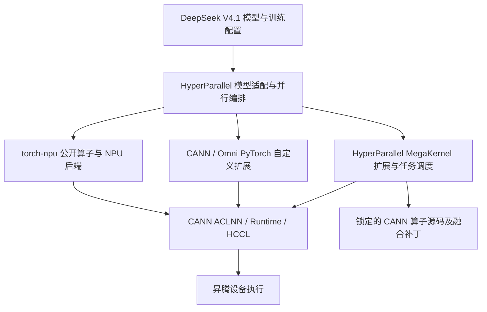

# DeepSeek-V4.1-Flash 训练适配代码调研：HyperParallel、torch-npu 与 CANN 分层贡献

本文为 [README.md 第二节](README.md#二聚焦模型技术创新hyperparallel-面向昇腾超节点构建高效训练支撑)补充技术内容提供源码依据，按其中六个技术点组织。调研日期为 **2026-10-16**，同时覆盖 HyperParallel 主干与相关开放 PR；本文不修改原文章，也不新增训练实测结论。

核心结论：这项适配由模型与分布式训练编排、PyTorch 昇腾后端、设备算子三个层次共同支撑。**HyperParallel 把新架构的训练语义、参数布局、跨层状态和并行策略组织起来；torch-npu 提供 NPU Tensor 执行、算子接入与通信后端；CANN 提供融合算子、核内计算和运行时能力。** 此外还存在 Omni 自定义扩展、HyperParallel 自有 MegaKernel 和可选外部算子后端，不能全部归入 torch-npu 的内置接口。

## 1. 调研口径与代码基线

| 对象 | 本文核查基线 | 说明 |
| --- | --- | --- |
| HyperParallel 主干 | [`5f8506091397852e9eb7e842e04bfc99de4587da`](https://github.com/mindspore-ai/hyper-parallel/tree/5f8506091397852e9eb7e842e04bfc99de4587da) | 本文“主干已有”均指此快照；不等于已发布版本 |
| HyperParallel PR | 见第 5 节的 PR 状态及 head SHA | 已读取 PR 描述、变更文件及重点分支源码；开放 PR 的代码不能写成已合入 |
| torch-npu / Ascend PyTorch | [`82e23aafd4af22789b4ebadbf5ce24bddff201a2`](https://github.com/Ascend/pytorch/tree/82e23aafd4af22789b4ebadbf5ce24bddff201a2) | 用于确认项目职责与 op-plugin 依赖；不是 README 实测环境的包版本 |
| torch-npu 的 op-plugin | [`763f7aecc36c84d13a35313b7e4deffdbcfc94c1`](https://github.com/Ascend/op-plugin/tree/763f7aecc36c84d13a35313b7e4deffdbcfc94c1) | 补查 Python 算子接口至 CANN ACLNN 的实际桥接 |
| CANN ops-transformer | [`3bc27021d6533ab3e14abc3e2e59424625794316`](https://gitcode.com/cann/ops-transformer/tree/3bc27021d6533ab3e14abc3e2e59424625794316) | 补查 LI V2、SparseFlashMla、KL 和 mHC 的上游源码；实际 PR 可能锁定更早版本 |

证据分三类：**主干源码事实**、**PR 源码／作者报告**、**依赖能力与职责判断**。本文没有在 t129 或其他 NPU 上重跑训练。引用 PR 中的精度或性能结果时，均属于作者报告，不能当作本次独立复测。

分层归因也有边界：从 HyperParallel 调用点和上游源码，可以确认各项目提供了什么能力；若未找到 torch-npu/CANN 对应的具体适配 PR，不能进一步断言“该接口由某项目组为本次 V4.1 新增”。下文将“复用已有能力”与“V4.1 专项改动”分开描述。

## 2. 三层如何衔接

三条算子接入路径都依赖相容的 PyTorch、torch-npu 和 CANN 环境，但并非都经由 `torch_npu.npu_*` 公开接口：

| 层次 | 在本次适配中的具体工作 | 直接代码依据 |
| --- | --- | --- |
| HyperParallel 模型／前端 | V4.1 模型注册、组件替换、参数和激活布局、CSA2 共享状态、TP/CP/EP/FSDP、重计算、CPU Engram、优化器与 Trainer 接线 | [模型注册][hp-registration]、[分片策略][hp-sharding]、[训练配置][hp-recipe] |
| torch-npu 与 op-plugin | 支撑 NPU Tensor 与普通 Torch 运算；提供 GroupedMatmul、RoPE、RMSNorm、Token Permute 等接口，将其桥接到 ACLNN；承载 NPU 侧分布式执行 | [Ascend PyTorch][torch-readme]、[GroupedMatmul 桥接][op-gmm]、[RoPE 桥接][op-rope] |
| CANN | 提供 LI V2、稀疏 MLA 前反向、Indexer KL 梯度、mHC 等融合计算；提供 AI Core 实现、调度元数据、ACLNN 和运行时／通信基础 | [LI V2 扩展][cann-li]、[SMLA 扩展][cann-smla]、[KL 扩展][cann-kl]、[mHC 文档][cann-mhc] |
| HyperParallel 仓内设备侧工作 | 在 CANN 基础原语上组织 MegaMhc/MegaMoe 的任务图、事件、worker 与自定义扩展；这部分超出 Python 前端 | [MegaMhc 任务图][hp-mhc-graph]、[C++ 桥接][hp-mhc-bridge]、[依赖锁文件][hp-lock] |
| 其他扩展 | 主干部分训练算子由 `omni_training_custom_ops` 注册；另有开放 PR 接入 TileKernels、DeepSelect 等 | [主干共享 Attention][hp-shared]、[PR #1051](https://github.com/mindspore-ai/hyper-parallel/pull/1051) |

**适合文章使用的总体归因：** HyperParallel 团队负责模型训练语义与并行系统适配，并承担部分 MegaKernel 融合编排；torch-npu 团队提供 PyTorch 到昇腾设备的执行和算子桥接能力；CANN 团队提供设备计算、融合算子和运行时基础。三层共同完成训练链路，具体算子的代码归属按实际调用路径说明。

## 3. 对应 README 第二节的六项适配工作

### 3.1 Causal Encoder-Decoder：将非对称架构转为可训练、可切分的模型结构

**HyperParallel 主干工作。** `DeepseekV41Model` 在 Transformers DeepSeek V4 组件基础上实现 V4.1 自有结构。构建时依据 `v41_compress_ratios`、`v41_kv_source_layer_ids`、`v41_index_source_layer_ids` 确定各层的压缩率与状态生产／复用角色；训练前向创建一份 `SharedAttentionState` 并贯穿层调用，使跨层依赖进入 autograd 和重计算边界。模型保留 decoder module 调用边界，供 FSDP 包装与激活重计算使用。[模型实现][hp-model]、[配置构建][hp-crop]

框架侧进一步明确参数切分角色：注意力 Q 投影、输出低秩投影和 sinks 按规则切分；共享 KV 投影、压缩器、Indexer K 等保持相应复制布局；视觉模块与 Engram 子模块具有专门的 FSDP 包装和执行顺序。这些工作使结构不同、状态不同的层能够接入统一分布式构建过程。[分片与执行顺序][hp-sharding]

**torch-npu / CANN 的位置。** 此处没有证据表明存在一个独立的“CED 整体算子”。torch-npu/CANN 支撑构成各层的投影、归一化、Attention 和通信；跨层角色以及状态依赖的组织属于 HyperParallel 模型／框架层。

**表述边界。** 当前训练前向显式拒绝 `use_cache=True` 和非空 `past_key_values`。因此可以写“完成 CED 相关层结构与跨层依赖的训练适配”，不能据此写“已实现完整 Prefill/Decode 推理链路”，也不能将 README 中约 8B/16B 激活参数直接当作本次训练性能收益。另需区分这里的语言模型 CED 与 3.6 节的视觉 Encoder Parallel，二者并非同一概念。[训练 forward][hp-model]

可供第二节改写：

> 面向 CED 架构带来的层间非对称性，HyperParallel 根据模型配置组织不同层的计算与状态角色，建立跨层状态传递、参数分片和重计算边界，使新架构能够接入统一分布式训练流程。torch-npu 与 CANN 则为各层计算和通信提供昇腾执行基础。

### 3.2 CSA2：共享语义、并行通信与融合算子共同适配

#### 主干已有：跨层共享与完整训练语义

| 适配点 | HyperParallel 代码中的具体实现 | 来源 |
| --- | --- | --- |
| Full / Reindex / Reuse | `SharedCompressedAttentionState` 分别维护 compressed KV、Indexer K、Top-K、候选块；生产层发布，消费层按 source layer 读取 | [共享 Attention][hp-shared]、[模型层角色][hp-model] |
| 分层索引 | Full 层建立 block-max 候选池，后续 Reindex 在候选块内评分；包含最新可见 partial block 的处理，不能用普通全局 Top-K 替代 | [候选选择函数][hp-shared] |
| Indexer 训练 | `shared_compressed_indexer_kl_loss` 实现 selected-compressed-KV 与 sink 对应的 teacher 目标及 Indexer 辅助梯度注入 | [Indexer KL][hp-shared] |
| TP | Indexer Q 与 merge heads 局部计算，跨 TP 汇总 score／teacher 贡献后再确定全局选择；参数布局单独声明 | [TP/CP wrapper][hp-cp]、[分片策略][hp-sharding] |
| CP | Q 与 Top-K 保留序列局部布局；raw KV、compressed KV、Index K 使用可微异步 AllGather，launch/wait 分离以配合局部计算 | [TP/CP wrapper][hp-cp] |
| 安全重计算 | 按 Full/Reindex/Reuse 角色划定区域；对重算的离散选区固定前向结果，重放不重复发布共享条目；状态作为区域输入保持到反向消费结束 | [重计算策略][hp-recompute]、[共享状态策略][hp-state] |

重计算能力已有主干代码，相关 [#1080](https://github.com/mindspore-ai/hyper-parallel/pull/1080) 与 [#1154](https://github.com/mindspore-ai/hyper-parallel/pull/1154) 已合入；仍开放的同主题 [#1096](https://github.com/mindspore-ai/hyper-parallel/pull/1096) 不应使文章误判为“该能力尚未进入主干”。当前源码默认 attention 重计算档位为 `reuse`，不是所有角色都重算；训练配置还需实际启用重计算。

#### 主干算子路径：Omni 扩展与 HyperParallel scalar-sink 适配

`SharedCompressedDSAAttention` 的 NPU 主 Attention 调用 `torch.ops.custom.npu_sparse_flash_attention_enhance` 及对应反向，依赖 `omni_training_custom_ops` 注册。`_NpuSparseAttentionWithScalarSink` 由 HyperParallel 负责张量组织、scalar sink 的桥接以及前反向接线。[实际调用点][hp-shared]

这条路径可以描述为“HyperParallel 接入昇腾自定义稀疏 Attention 训练算子”。不能仅因函数名带 `npu` 就将其记为 torch-npu 内置算子，也不能把 HyperParallel 的 sink 桥接逻辑记为底层 kernel 的改动。

#### 开放 PR：不同融合路线与通信优化

| PR / 状态 | HyperParallel 适配工作 | 底层能力与关键限制 |
| --- | --- | --- |
| [#953](https://github.com/mindspore-ai/hyper-parallel/pull/953)，OPEN | 在模型家族 adapter 中接入可选 Indexer provider；因果 Top-K、候选池生成、候选内重选分别处理；规范化 ID、控制 gather 临时量并记录实际融合是否生效 | Omni `npu_lightning_indexer_enhance`；候选内重选仍用优化后的 Torch 计算。要求支持 `sparse_mode=4` 的配套扩展；默认缩宽 recipe 的 Indexer 头数可能无法命中融合路径。[适配源码][pr953-provider] |
| [#1016](https://github.com/mindspore-ai/hyper-parallel/pull/1016)，OPEN，目标 `trainer_dev` | 用 `use_fused_kernels` 接入 LI V2、V4 SMLA 前反向及 KL 梯度；保持外部 teacher、标量 KL、辅助梯度缩放；处理 r1/r2、packed、partial/empty 行和元数据缓存 | 依赖匹配的 CANN ops-transformer 扩展；显式启用后不支持的调用直接报错。不是主干现成配置。[Indexer 包装][pr1016-indexer] |
| [#1068](https://github.com/mindspore-ai/hyper-parallel/pull/1068)，OPEN，目标 `master` | `use_fused_ops` 选择 LI V2、SparseFlashMla/SparseFlashMlaGrad、KL 梯度；新增 BSND/TND 布局适配、packed 文档合批、索引坐标和 metadata 缓存，减少 selected-key gather 与 teacher 临时量 | 直接按需导入 `cann_ops_transformer`；CANN 执行融合计算，HyperParallel 保留模型 teacher 目标与 autograd 接线。普通因果 r1/r2、TP1；candidate pool 未融合；显式启用禁止静默回退。[接口说明][pr1068-readme]、[LI 包装][pr1068-li]、[SMLA 包装][pr1068-smla]、[KL 包装][pr1068-kl] |
| [#1194](https://github.com/mindspore-ai/hyper-parallel/pull/1194)，OPEN | `index_select` 替换昂贵高级索引；新增 `csa2_cann_target` 替换入口；补充嵌套 FSDP 单元的反向预取顺序 | 同样使用 CANN 扩展，但其 `supports_*` 当前仅放行特定形状，核心条件包含 `compress_ratio==4`；不支持形状回父实现。不能与 #1068 的 r1/r2／强制融合策略混写。[能力判定][pr1194-cann]、[替换入口][pr1194-target] |
| [#990](https://github.com/mindspore-ai/hyper-parallel/pull/990)，OPEN，目标 `trainer_dev` | SWA 改用左侧 halo 的变长 AllToAll；AllGather 反向改 SUM ReduceScatter；缓存 packed 几何，修复 scalar sink／参考 KL 数值；可选融合 Indexer/KL | 主 Attention 仍是 Omni，不切换到 V4 SMLA；main KV/Index K 仍 AllGather；candidate 路径保留参考实现。[分层说明][pr990-doc] |
| [#1143](https://github.com/mindspore-ai/hyper-parallel/pull/1143)，OPEN，依赖 #1068 | SWA halo，main KV/Index K 可配置 AllGather 或按需 AllToAll；自然长度 packed 文档压缩、变长 K bank、Indexer zigzag/greedy/hybrid 任务均衡与结果回传 | 均衡的是 Indexer 选择任务；主 Attention、teacher、KL 保留原 Q owner。其分支含 #1068 前置改动，不能重复计为两套独立融合收益。[CP wrapper][pr1143-cp] |
| [#1102](https://github.com/mindspore-ai/hyper-parallel/pull/1102)，OPEN | 根据共享条目的全部读者与最后消费者，接入 CPU activation swap；反向按层预取 | 卸载的是跨层共享激活状态；与 Engram 参数表 CPU 常驻不同。要求选择性重计算等特定配置。[状态生命周期][pr1102-state] |

**CANN 与 torch-npu 的确切边界。** CANN 仓库自己的 PyTorch 扩展中，`lightning_indexer.cpp` 调用 `aclnnLightningIndexerV2`，`sparse_flash_mla.cpp` 调用 `aclnnSparseFlashMla`，KL 扩展调用 `aclnnSparseLightningIndexerKLLossGrad`。这证明融合算法与设备实现来自 CANN，而不是 HyperParallel 用 Python 重写。[CANN LI][cann-li]、[CANN SMLA][cann-smla]、[CANN KL][cann-kl]

torch-npu/op-plugin 也存在 `npu_lightning_indexer` 与 `npu_sparse_flash_attention` 的桥接实现，但它们并不等于上述 PR 实际使用的 LI V2 / SMLA 扩展接口；不能仅凭名称相近就替换调用链。[op-plugin Indexer][op-li]、[op-plugin Sparse Attention][op-sparse]

RoPE 也存在模型语义与后端布局的衔接工作。开放 [#1189](https://github.com/mindspore-ai/hyper-parallel/pull/1189) 调整 interleaved RoPE 的 Tensor 组织，涉及模型、共享 Attention 和公共 rotary functional；公共函数通过 `torch_npu.npu_rotary_mul` 接入后端，op-plugin 再桥接 CANN RotaryPositionEmbedding。应将“模型旋转约定／布局适配”“后端接口支持”“设备旋转计算”分别归因。[PR RoPE 实现][pr1189-rope]、[op-plugin RoPE][op-rope]

**不宜外推的两点。** 本次查到的主干共享状态是普通训练 Tensor，模型还不支持推理 KV cache；因此不足以证明 README 所述 FP4 KV Cache／约 890 Bytes/Token 已在该训练实现落地。其次，#953 已将早期不可复现的端到端加速结论更正为特定裁剪配置下基本持平，#1068 的收益数据主要针对 Attention 模块；单选择链、单模块加速不能写成整网训练加速。

可供第二节改写：

> 面向 CSA2 的跨层 KV 与稀疏索引共享，HyperParallel 实现共享状态管理、分层候选选择和 Indexer 训练目标，并适配 TP、CP 及角色感知重计算。在此基础上，框架通过昇腾 PyTorch 扩展接入稀疏 Attention 训练算子，并在开放 PR 中进一步对接 CANN 的 LI V2、Sparse MLA 前反向与 Indexer KL 融合能力，协同优化模型语义、通信与设备计算。

### 3.3 Engram：从稀疏查表到设备／主机两种存储路径

**主干前端语义。** `NgramHashMapping` 实现 tokenizer 映射、按 n-gram/head 独立的哈希 bucket 与全表偏移；packed 样本边界阻止跨文档拼接，图像 token mask 避免将视觉 token 混入文本记忆。`DeepseekV41Engram` / `EngramModule` 保留 WKV 投影、Q/K 权重、signed-root gate 与残差融合语义。[哈希与 EP 组件][hp-engram]、[模型原生 Engram][hp-model]

**设备表与 EP。** recipe 声明 `embed.weight` 沿 EP 的行维切分；稀疏请求路由到持有相应行的 owner，再返回 embedding，并通过反向通信把梯度送回 owner。TP/SP、CP 下还需对齐 token mask 与查表输入，不能把它当作普通全表 AllGather。[训练布局][hp-recipe]、[Engram 组件][hp-engram]、[模型 EP 接线][hp-ep]

**CPU 常驻稀疏表已合入。** [#1075](https://github.com/mindspore-ai/hyper-parallel/pull/1075) 于 2026-10-16 合入，新增了完整的主机侧生命周期：

1. `HostEngramTable` 将 owner 的 FP32 参数行留在 CPU，避免随模型整体 `.to(device)` 移到 NPU，并从普通设备 FSDP 单元中排除。
2. `host_lookup` 先去重 ID、按 EP owner 请求 CPU 行，仅将命中行搬到设备并恢复原顺序；不是每步把整张表放入 HBM。
3. 反向累计命中行梯度，合并重复行和 microbatch，执行跨并行域同步、有限值检查和裁剪；以 CPU SparseAdam 更新。
4. 通过外部状态 provider、独立 checkpoint sidecar 与 dense optimizer 协调保存和恢复表及优化器状态。[CPU 表][hp-host-table]、[查表前反向][hp-host-lookup]、[训练状态 provider][hp-host-state]、[优化器协调][hp-host-optim]、[checkpoint][hp-host-checkpoint]

**torch-npu / CANN 贡献。** 当前 Host 路径的哈希、去重、CPU 行管理和优化器协调属于 HyperParallel；设备 Tensor、数据搬运与 NPU 通信依赖 torch-npu 及底层运行时/HCCL。现有证据不足以写成“CANN 专门实现了此 Host Engram 方案”。WKV 投影、归一化等设备计算仍由其执行栈支撑。

开放 [#1051](https://github.com/mindspore-ai/hyper-parallel/pull/1051) 另接入 TileKernels 的 Engram 等可选模块，属于外部后端路线；不能与已经合入的 Host 表混为一项能力。[可选后端说明][pr1051-doc]

**必须保留的限定。** Host 稀疏表当前用 SparseAdam，并仍需 CPU 权重及优化器状态内存；不能据“稀疏更新”推导为优化器状态也只按访问行稀疏分配。它与 3.4 节稠密梯度 Sinkhorn 方案不自动等价；Host 外部状态当前还声明不支持异步 checkpoint。[Host 状态实现][hp-host-state]、[Host 优化器][hp-host-optim]

可供第二节改写：

> 面向 Engram 超大条件记忆表，HyperParallel 实现确定性 N-gram 哈希、EP 按行分片与稀疏请求路由，并提供 CPU 常驻表、命中行搬运、稀疏梯度更新和配套检查点能力。结合 torch-npu 与 CANN 的设备执行和通信基础，这一方案将参数存储、查表流量和设备计算分开管理，为降低 HBM 压力提供实现路径。

### 3.4 Head-wise Muon 与 Sinkhorn：主要是前端分布式优化器工作

**当前主干与开放改动应分开。** 主干已有普通 Muon 分布式优化器，文本 recipe 使用 `components.optim.Muon` 及 AdamW 配置；Head-wise Muon、优化器 Sinkhorn 与三优化器组合集中在开放 [#1065](https://github.com/mindspore-ai/hyper-parallel/pull/1065)，尚不能称为主干默认训练能力。[主干 Muon][hp-muon]、[主干 recipe][hp-recipe]

| PR #1065 的改动 | HyperParallel 的具体工作 | 对底层的依赖 |
| --- | --- | --- |
| Head-wise Muon | 新增 `head_wise` 和 `head_wise_patterns`；在已有 gather 后按指定 head 宽度重排 Q/K 更新矩阵，逐 head 执行 Newton–Schulz，再恢复布局 | 复用 Torch/NPU 矩阵运算和分布式 gather；未找到新增专属 CANN Head-wise Muon kernel 的证据 |
| 分布式 Sinkhorn | 保存分片 FP32 momentum，沿切分相应维度的 mesh 轴归约行／列范数统计；参数更新保持本地 shard，不为 balancing 收集整矩阵 | torch-npu 执行向量运算，HCCL 支撑统计量归约；算法、布局及状态所有权由 HyperParallel 实现 |
| 参数分组与组合 | `ComposedOptimizer` 组合 Muon、Sinkhorn、AdamW；显式正则参数组、学习率、ownership/state key 与 FP32 主参数接线 | 训练系统工作，无须将其归为 CANN 算子创新 |
| V4.1 参数布局 | recipe 对主 Attention 与 Indexer 分别指定 512／128 的 head width；对 Engram embedding 设置独立学习率 | 必须与实际参数 head 布局匹配，不能把所有二维权重都按同一个 head 宽度切分 |

代码入口：[head-wise Muon][pr1065-muon]、[Sinkhorn 优化器][pr1065-sinkhorn]、[组合 builder][pr1065-builder]、[PR recipe][pr1065-recipe]。PR 作者报告包含 NPU 分片、HSDP 和优化器状态恢复等回归，但未声称复现完整模型长期收敛。

**避免两个 Sinkhorn 混淆。** 主干 `components/functional/sinkhorn.py` 用于 mHC 的连接矩阵归一化，存在 Omni 自定义前反向；PR #1065 的 `core/optimizer/sinkhorn.py` 用于参数更新的行列 L2 balancing、momentum、近零行处理等。二者目标、状态、计算公式和接口都不同。已有 mHC Sinkhorn 算子不代表训练优化器已经完成适配。[mHC functional][hp-sinkhorn]、[优化器实现][pr1065-sinkhorn]

可供第二节改写：

> 针对 V4.1 的参数结构，HyperParallel 在开放 PR 中扩展按注意力头执行的 Muon 更新，并实现保留分片动量、仅归约行列统计量的分布式 Sinkhorn，配套声明式参数分组与多优化器组合。该项工作主要位于训练框架层，依托 torch-npu 与 CANN 提供的矩阵计算和通信能力执行。

### 3.5 Single-Pass mHC：前端流水语义与 CANN 原语上的 MegaKernel 融合

**模型语义适配。** `DeepseekV41PipelinedHyperConnection` 和 decoder forward 携带 `pre_mix` 等状态，按 V4.1 的跨边界混合关系执行 mHC。选择 `DeepseekV41HyperMegaMhc` 替换后，前一子层的 output/post/residual mix 推迟到下一计算边界处理；模型显式要求保留层的所有 mHC 边界统一采用 shifted 协议。遇到 Engram 或最终输出时，还需正确结清待处理残差。[模型 forward][hp-model]、[MegaMhc 替换][hp-mega-mhc]

**HyperParallel 仓内设备侧工作。** `mega_mhc/graph.py`、`plan.py` 和反向模块按 token tile 建立任务与事件依赖，组织 MhcPost、NormCast、Projection、InputMix、Mapping/Sinkhorn、RMSNorm 等步骤；`function.py` 管理训练 autograd 与所需中间状态。`ops/hyper_mega_mhc*` 提供仓内设备 worker、host API 与 tiling。这些代码说明 HyperParallel 的贡献还包括设备侧融合编排。[任务图][hp-mhc-graph]、[训练 Function][hp-mhc-function]、[设备 worker][hp-mhc-worker]

**CANN 的直接贡献有锁文件依据。** multicore 锁定 CANN ops-transformer 的 mHC 源码 `58b4a6bdeb29feeb0070dd266106bd4e130bb72b`，通过本仓补丁将 MhcPost、MhcPreSinkhorn 及反向实现暴露为 task-local 原语；RMSNorm 来自锁定的 ops-nn。CANN 提供原始数学算子与设备 kernel，HyperParallel 负责将这些原语整合进 shifted pipeline 和任务调度。[依赖及补丁说明][hp-lock]、[CANN MhcPreSinkhorn][cann-mhc]

**torch-npu 的桥接贡献。** 本仓 C++ 扩展引用 `op_plugin/include/npu_cpp_extension.h`，用 `EXEC_NPU_CMD_EXT` 调用 `aclnnMhcPreSinkhorn`、`aclnnHyperMegaMhc`、`aclnnHyperMegaMhcGrad`；schema 注册在 `torch.ops.hyper_parallel`，而不是 torch-npu 自带的 `torch.ops.npu`。因此应写为“使用 torch-npu 扩展机制接入”，而非“MegaMhc 全部由 torch-npu 实现”。[C++ 桥接][hp-mhc-bridge]、[schema 注册][hp-mhc-schema]

**状态与限制。** 主干已包含 MegaMhc 训练前反向与替换代码；[同主题 #1025](https://github.com/mindspore-ai/hyper-parallel/pull/1025) 仍开放且目标为 `trainer_dev`，不能据其状态否认主干已有实现。模型替换显式限制 `hc_mult=4`、`hc_sinkhorn_iters=20`，需要匹配的 multicore 原生构建；含 CPU 参考分支不代表验证了 NPU kernel。本文不据 README 的“推理访存降低”推导训练整步性能数字。

可供第二节改写：

> 面向 Single-Pass mHC，HyperParallel 完成跨子层混合与残差状态的训练语义适配，并在 CANN 的 MhcPost、MhcPreSinkhorn、RMSNorm 等原语上构建 MegaMhc 任务流水及反向执行。torch-npu 的自定义扩展机制将该融合路径接入 PyTorch，体现了模型编排、后端桥接与设备算子的协同。

### 3.6 原生多模态 MoE：视觉并行、专家计算与训练目标分别适配

**多模态主干已有。** `vision.py` 实现 DeepSeek-ViT 的 patch embedding、2D RoPE、视觉 Attention/MLP 与 aligner；模型将视觉特征插入指定文本序列位置，传递 image mask，并用其屏蔽 Engram 文本记忆。模型自有 data processor/runtime 以及 VLM recipe 将图像元数据接入统一训练流程。[视觉实现][hp-vision]、[图像注入与 mask][hp-model]、[VLM recipe][hp-vlm-recipe]

已合入 [#1132](https://github.com/mindspore-ai/hyper-parallel/pull/1132) 进一步提供视觉 Encoder Parallel：将图像解析为 work items，按视觉 CP 切分 patch 序列，通过 Ulysses 在 sequence/head 布局间转换，并将投影结果路由至语言模型相应 token 区间。视觉模块有独立 FSDP 单元，aligner 避免误用通用线性 TP 启发式。其模型 adapter 当前限制 microbatch=1，视觉重计算等组合也有显式约束。[Encoder adapter][hp-encoder]、[FSDP 策略][hp-sharding]

**MoE 主干计算适配。** `DeepseekV41TopKRouter` 保留文本／图像 correction bias 的路由选择接口；专家分片与 dispatch/combine 使用 HyperParallel EP 基础设施。V4.1 adapter 额外保留其 FP32 clipped SwiGLU：gate 分支上界 clamp、up 分支对称 clamp，计算后转回原 dtype 再做 down projection；共享专家也绑定相同数学语义，避免普通 SwiGLU 替换改变模型。[Router 与 SwiGLU][hp-model]、[EP grouped expert][hp-ep]

**torch-npu 和 CANN 计算链。** 主干 Grouped GEMM 包装调用 `torch_npu.npu_grouped_matmul`，包括前向以及 dX/dW 等反向接线；op-plugin 的对应 C++ 实现负责输出组织、接口兼容与 ACLNN 调用，CANN 执行 grouped matmul kernel。Token Permute/Unpermute 等也有 torch-npu 封装。V4.1 clamp 激活在当前这条 grouped-GEMM 路径中仍由 HyperParallel 的 FP32 Torch 公式完成，不能写成“整个 clipped expert 已融合为一个 torch-npu 算子”。[HyperParallel GMM][hp-gmm]、[op-plugin GMM][op-gmm]、[V4.1 专用路径][hp-ep]

**MegaMoe 与 MegaGate。** 主干已合入 [#1063](https://github.com/mindspore-ai/hyper-parallel/pull/1063) 的 V4.1 MegaGate 替换；clamp 的 [#855](https://github.com/mindspore-ai/hyper-parallel/pull/855) 通过对锁定 CANN ops-nn 源码施加补丁，提供 MegaMoe 前反向 clipped SwiGLU。开放 [#985](https://github.com/mindspore-ai/hyper-parallel/pull/985) 继续补充 V4.1 MegaMoe 替换、动态 token 工作量／容量管理及训练接线；开放 [#847](https://github.com/mindspore-ai/hyper-parallel/pull/847) 则是接入官方 Clipped SwiGLU kernel 的另一来源路线。应区分“底层 clamp 已有”与“某条模型 MegaMoe 组合仍在 PR 中”。[MegaGate adapter][hp-mega-gate]、[CANN 原语与补丁锁定][hp-lock]、[PR #985 模型接线][pr985-megamoe]

**模态负载均衡训练仍有开放工作。** [#1067](https://github.com/mindspore-ai/hyper-parallel/pull/1067) 新增按逻辑样本计算的 seq-auxloss，以及 text/image 独立计数和每训练步 correction bias 更新。实际 dispatch 使用带 bias 的 Top-K，seq 目标使用未加 bias 的 Top-K；计数在 backward 累积，避免重计算重复统计，再按并行统计域归约。这里是 HyperParallel 的模型训练算法和生命周期适配，不是路由 kernel 本身。主干能按模态 bias 选择专家，不等于完整训练期 bias 更新已合入。[负载均衡算法][pr1067-aux]、[Trainer 接线][pr1067-trainer]

可供第二节改写：

> 面向原生多模态 MoE，HyperParallel 统一接入视觉编码、图文特征注入与语言主干，并组合视觉并行、专家并行和参数分片；专家计算通过 torch-npu 对接 CANN GroupedMatmul 等基础算子，同时保留 V4.1 的 clipped SwiGLU 语义。MegaGate/MegaMoe 融合路径及开放 PR 中的分模态负载均衡进一步完善路由、设备执行和训练目标之间的衔接。

## 4. 可直接用于第二节的分层贡献总表

| README 技术点 | HyperParallel 适配贡献 | torch-npu 贡献 | CANN 贡献 | 当前写作口径 |
| --- | --- | --- | --- | --- |
| CED | 层角色、跨层依赖、模型调用边界、分片与重计算接线 | NPU 执行后端 | 构成各层的计算／通信基础 | 可写训练结构适配；不写推理 Prefill/Decode 全链路已验证 |
| CSA2 | 共享 bank、分层索引、teacher/KL、TP/CP、重计算；开放 PR 优化 halo/任务均衡与融合接入 | NPU Tensor／通信与扩展支持；部分基本算子桥接 | 稀疏 Attention、LI V2、SMLA 前反向、KL 梯度及 metadata | 主干路径与开放融合 PR 分开；FP4 cache 暂无落地证据 |
| Engram | 哈希语义、EP 行分片、稀疏路由、CPU 常驻表、命中行搬运、SparseAdam 与 sidecar | 设备搬运和通信后端 | 运行时/HCCL 及投影等计算基础 | Host 路径已合入；不等同于 Sinkhorn 路径 |
| Head-wise Muon / Sinkhorn | 逐 head 更新、分片 momentum、统计量归约、参数组与组合优化器 | 矩阵/向量计算及分布式执行 | 设备计算和集合通信 | #1065 仍 OPEN；属于框架算法适配为主 |
| Single-Pass mHC | shifted 模型语义、MegaKernel 任务图、事件和反向、仓内设备融合 | 扩展与 ACLNN 桥接机制 | mHC/RMSNorm 原始 kernel、ACLNN 与执行基础 | 主干已有；按锁定原语与本仓融合分别归因 |
| 多模态 MoE | ViT/aligner、视觉并行、EP、clamp 语义、路由接线；开放 PR 完善模态负载均衡／动态 MegaMoe | GroupedMatmul、Token Permute 等接口和后端 | GMM、SwiGLU/归一化等原语与通信基础 | 不把已有模态路由接口等同于完整负载均衡训练已合入 |

推荐总述：

> DeepSeek-V4.1-Flash 的训练适配贯穿模型、框架后端和设备算子三个层次。HyperParallel 围绕跨层状态、稀疏参数与新型优化器完成训练语义和并行编排，并基于 CANN 原语开展 MegaKernel 融合；torch-npu 提供 PyTorch 与昇腾之间的执行及算子桥接能力；CANN 提供融合算子、设备计算和运行时支撑。三方通过接口、布局、前反向及数值契约的协同，使新模型特性能够进入统一训练流程，相关优化仍在持续合入。

## 5. PR 状态与版本索引

以下状态是调研时快照。**PR 仍开放，不代表其所有代码都尚未进入主干；PR 已合入，也不代表功能组合或完整模型训练已验收。** 尤其 #1096/#1080/#1154、#1025 和多个融合适配分支应结合主干文件与目标分支判断。

| PR | 调研时状态 | 目标分支 | 核查 head SHA | 本文对应工作 |
| --- | --- | --- | --- | --- |
| [#811](https://github.com/mindspore-ai/hyper-parallel/pull/811) | MERGED，2026-09-17 | `trainer_dev` | `a8e6e6c4d5de149a6aeb68bf46b26ded2c0a2597` | 早期模型适配入口 |
| [#1050](https://github.com/mindspore-ai/hyper-parallel/pull/1050) | MERGED，2026-10-09 | `master` | `bd90c7063e007f0e9d91ea0411bc4386ce3ee942` | 训练开发分支并入主干 |
| [#1075](https://github.com/mindspore-ai/hyper-parallel/pull/1075) | MERGED，2026-10-16 | `master` | `d03050eb05869977305672701db45194f64fa3ec` | CPU 常驻稀疏 Engram |
| [#1066](https://github.com/mindspore-ai/hyper-parallel/pull/1066) | MERGED，2026-10-12 | `master` | `28e76ecd9c62e32b82320e9beec8560b3b3792bb` | V4.1 clamp Grouped GEMM |
| [#1063](https://github.com/mindspore-ai/hyper-parallel/pull/1063) | MERGED，2026-10-15 | `master` | `044ad8909fe60bae384a39f6b6795faa9f401f5a` | V4.1 MegaGate |
| [#855](https://github.com/mindspore-ai/hyper-parallel/pull/855) | MERGED，2026-10-14 | `master` | `494bac8b44b2fa7144a295af7008c07a8e125507` | 锁定 ops-nn 上的 clamp 补丁 |
| [#1132](https://github.com/mindspore-ai/hyper-parallel/pull/1132) | MERGED，2026-10-14 | `master` | `5f15b88ad09979b1f362079fcba82d7e0ea64988` | 视觉 Encoder Parallel |
| [#1080](https://github.com/mindspore-ai/hyper-parallel/pull/1080) | MERGED，2026-10-14 | `master` | `2a8a9a332b8758bcc4ce9677c1fcbcc23f55ea24` | CSA2 层级重计算 |
| [#1154](https://github.com/mindspore-ai/hyper-parallel/pull/1154) | MERGED，2026-10-14 | `master` | `2a8a9a332b8758bcc4ce9677c1fcbcc23f55ea24` | 同主题重计算合入记录 |
| [#938](https://github.com/mindspore-ai/hyper-parallel/pull/938) | MERGED，2026-10-15 | `master` | `de29235ed5f642f818064815e13ecef97ec0aaf3` | 选择性重计算的缓存改写修复 |
| [#1065](https://github.com/mindspore-ai/hyper-parallel/pull/1065) | OPEN | `master` | `7487630a3edfb752c31bb3d4bbdbdfd45870ead7` | Head-wise Muon + Sinkhorn + AdamW |
| [#953](https://github.com/mindspore-ai/hyper-parallel/pull/953) | OPEN | `master` | `4da7d408c6bab511bad44f81ea63a1c0ffe89cff` | Omni 融合 Indexer provider |
| [#1016](https://github.com/mindspore-ai/hyper-parallel/pull/1016) | OPEN | `trainer_dev` | `6d3d646a013d47a3fd7425435a1bd05593c3732e` | 预训练融合算子早期分支 |
| [#1068](https://github.com/mindspore-ai/hyper-parallel/pull/1068) | OPEN | `master` | `dc95aabd501e27dff7162adad425a75d7531c521` | 面向主干的 LI/SMLA/KL 融合 |
| [#1194](https://github.com/mindspore-ai/hyper-parallel/pull/1194) | OPEN | `master` | `c245fd7e093c1ffe71f2dd0c5989c21757dd07b3` | CANN 9.1 受限形状路径与 FSDP 预取 |
| [#990](https://github.com/mindspore-ai/hyper-parallel/pull/990) | OPEN | `trainer_dev` | `d8c16654eba32a5d4ad76c46ea98b7ba7d429d87` | 早期 CP halo/RS 与融合优化 |
| [#1143](https://github.com/mindspore-ai/hyper-parallel/pull/1143) | OPEN | `master` | `c7817233224f6345b6df0fa68e3e4c4c543240ab` | 自然 packed、按需 K 分发与 Indexer 均衡 |
| [#1102](https://github.com/mindspore-ai/hyper-parallel/pull/1102) | OPEN | `master` | `7d4aa44380812c8a4faaa4ab250f638c4fb19312` | 跨层共享激活 swap |
| [#1067](https://github.com/mindspore-ai/hyper-parallel/pull/1067) | OPEN | `master` | `9abdb116571947df9252abc9b77fd189a83110af` | 样本／模态负载均衡 |
| [#985](https://github.com/mindspore-ai/hyper-parallel/pull/985) | OPEN | `master` | `f930f6a85ab3b6c65146807cff55cc90f24777e9` | 动态 token 与 V4.1 MegaMoe |
| [#847](https://github.com/mindspore-ai/hyper-parallel/pull/847) | OPEN | `master` | `73f09787385d2f73b91f47fe853e0638c9ab87db` | 官方 Clipped SwiGLU 接入路线 |
| [#1025](https://github.com/mindspore-ai/hyper-parallel/pull/1025) | OPEN | `trainer_dev` | `3f9a4a63387eca8e67367014a49ee5f3759c5e48` | 同主题 MegaMhc 开发分支 |
| [#1096](https://github.com/mindspore-ai/hyper-parallel/pull/1096) | OPEN | `master` | `5c3827009ddfa34ce2fa431949b4cb36840d7ac2` | 同主题 CSA2 重计算开放分支 |
| [#1051](https://github.com/mindspore-ai/hyper-parallel/pull/1051) | OPEN | `master` | `7153ecd5c97140e546ce191ae8aac8e5b60c2c19` | 可选 DeepSeek Ascend 外部后端 |
| [#1189](https://github.com/mindspore-ai/hyper-parallel/pull/1189) | OPEN | `master` | `52b9e295270186cbf1def465ba3b139897b27eeb` | Interleaved RoPE 布局优化 |

其他配套工作：[初始 V4.1 适配 #811](https://github.com/mindspore-ai/hyper-parallel/pull/811)、[trainer_dev 合入 master #1050](https://github.com/mindspore-ai/hyper-parallel/pull/1050)、[DSpark #928](https://github.com/mindspore-ai/hyper-parallel/pull/928) 均已合入；DSpark 超出 README 第二节当前六项主题，本文仅将其视为训练适配的补充。

初始化还存在开放修复 [#1101](https://github.com/mindspore-ai/hyper-parallel/pull/1101)、[#1157](https://github.com/mindspore-ai/hyper-parallel/pull/1157)，涉及多维分片 embedding 的 padding 行置零。这些属于 HyperParallel/DTensor 初始化适配，不能无证据归为 torch-npu/CANN 故障，也提示不要把某一并行配置跑通外推为任意混合拓扑可用。

## 6. 后续补写文章时需要保持的证据边界

- **训练实现与模型报告分开。** 552B、196B、1M、FP4 KV 等可作为 README 的模型背景；是否完成对应完整规模训练，需另有配置、日志及验收证据。本次源码调研不替模型报告核验这些数字。
- **三个“已有”分别写。** 上游存在算子、HyperParallel 已有接入、目标配置实际命中并完成训练，是三种证据；不能由前一项推导后一项。
- **环境逐路线记录。** README 训练环境是 torch/torch-npu 2.9、CANN 9.1；#1068 报告的融合验证使用 2.10、CANN 9.0 和特定 ops-transformer 源码；#1051 的 A5 验证又使用 2.13/CANN 9.2。不能拼成同一套已测环境。[#1068 依赖说明][pr1068-readme]、[#1051 后端说明][pr1051-doc]
- **收益逐层记录。** kernel、Indexer 选择链、Attention 模块、裁剪模型整步和完整模型是不同统计对象；CPU 参数卸载与 activation swap 也不可合并计算收益。
- **候选池、packed、TP、重计算等组合分别看。** #1068 的普通因果融合并未覆盖 candidate pool，#953 的候选链方案又有独立算子版本／头数门槛；不同 PR 不能简单叠加成一份万能支持矩阵。
- **训练算法不能因换 kernel 而改变。** teacher 定义、有效 Top-K 槽位、scalar sink、packed 文档隔离和辅助梯度缩放属于模型训练契约；其保持和适配是 HyperParallel 的实质工作。
- **归因以项目和代码层次为依据。** 可明确三方协同支撑；尚未逐一核实底层专项 PR 的部分，写“提供／复用某能力”，不写成已经证实的 V4.1 新增研发事项。

当前可据代码明确展开的主线是：**跨层共享与重计算 → 稀疏表的分片和异构存储 → 结构感知优化器 → CANN 原语上的融合流水 → 多模态与专家并行组合。** 这比单纯复述模型结构更能说明 HyperParallel、torch-npu 与 CANN 在训练适配中的各自工作。

[hp-registration]: https://github.com/mindspore-ai/hyper-parallel/blob/5f8506091397852e9eb7e842e04bfc99de4587da/hyper_parallel/models/deepseek_v41/adapter/registration.py
[hp-sharding]: https://github.com/mindspore-ai/hyper-parallel/blob/5f8506091397852e9eb7e842e04bfc99de4587da/hyper_parallel/models/deepseek_v41/adapter/policies/sharding.py
[hp-recipe]: https://github.com/mindspore-ai/hyper-parallel/blob/5f8506091397852e9eb7e842e04bfc99de4587da/examples/training_demo/deepseek_v41/train_deepseek_v41_online.yaml
[hp-vlm-recipe]: https://github.com/mindspore-ai/hyper-parallel/blob/5f8506091397852e9eb7e842e04bfc99de4587da/examples/training_demo/deepseek_v41/train_deepseek_v41_vlm_online.yaml
[hp-model]: https://github.com/mindspore-ai/hyper-parallel/blob/5f8506091397852e9eb7e842e04bfc99de4587da/hyper_parallel/models/deepseek_v41/modeling_deepseek_v41.py
[hp-crop]: https://github.com/mindspore-ai/hyper-parallel/blob/5f8506091397852e9eb7e842e04bfc99de4587da/hyper_parallel/models/deepseek_v41/adapter/validation/cropped_model.py
[hp-shared]: https://github.com/mindspore-ai/hyper-parallel/blob/5f8506091397852e9eb7e842e04bfc99de4587da/hyper_parallel/components/modules/shared_compressed_dsa_attention.py
[hp-cp]: https://github.com/mindspore-ai/hyper-parallel/blob/5f8506091397852e9eb7e842e04bfc99de4587da/hyper_parallel/models/deepseek_v41/adapter/distributed/shared_attention_context_parallel.py
[hp-recompute]: https://github.com/mindspore-ai/hyper-parallel/blob/5f8506091397852e9eb7e842e04bfc99de4587da/hyper_parallel/models/deepseek_v41/adapter/policies/activation_checkpointing.py
[hp-state]: https://github.com/mindspore-ai/hyper-parallel/blob/5f8506091397852e9eb7e842e04bfc99de4587da/hyper_parallel/models/deepseek_v41/adapter/policies/shared_state.py
[hp-engram]: https://github.com/mindspore-ai/hyper-parallel/blob/5f8506091397852e9eb7e842e04bfc99de4587da/hyper_parallel/components/modules/engram.py
[hp-ep]: https://github.com/mindspore-ai/hyper-parallel/blob/5f8506091397852e9eb7e842e04bfc99de4587da/hyper_parallel/models/deepseek_v41/adapter/distributed/moe_engram_expert_parallel.py
[hp-host-table]: https://github.com/mindspore-ai/hyper-parallel/blob/5f8506091397852e9eb7e842e04bfc99de4587da/hyper_parallel/models/deepseek_v41/adapter/engram/host_table.py
[hp-host-lookup]: https://github.com/mindspore-ai/hyper-parallel/blob/5f8506091397852e9eb7e842e04bfc99de4587da/hyper_parallel/models/deepseek_v41/adapter/engram/host_lookup.py
[hp-host-state]: https://github.com/mindspore-ai/hyper-parallel/blob/5f8506091397852e9eb7e842e04bfc99de4587da/hyper_parallel/models/deepseek_v41/adapter/engram/host_state.py
[hp-host-optim]: https://github.com/mindspore-ai/hyper-parallel/blob/5f8506091397852e9eb7e842e04bfc99de4587da/hyper_parallel/models/deepseek_v41/adapter/optim/host_sparse.py
[hp-host-checkpoint]: https://github.com/mindspore-ai/hyper-parallel/blob/5f8506091397852e9eb7e842e04bfc99de4587da/hyper_parallel/models/deepseek_v41/adapter/checkpoint/host_sidecar.py
[hp-muon]: https://github.com/mindspore-ai/hyper-parallel/blob/5f8506091397852e9eb7e842e04bfc99de4587da/hyper_parallel/core/optimizer/muon.py
[hp-sinkhorn]: https://github.com/mindspore-ai/hyper-parallel/blob/5f8506091397852e9eb7e842e04bfc99de4587da/hyper_parallel/components/functional/sinkhorn.py
[hp-lock]: https://github.com/mindspore-ai/hyper-parallel/blob/5f8506091397852e9eb7e842e04bfc99de4587da/hyper_parallel/core/multicore/_build/dependencies.lock.json
[hp-mega-mhc]: https://github.com/mindspore-ai/hyper-parallel/blob/5f8506091397852e9eb7e842e04bfc99de4587da/hyper_parallel/models/deepseek_v41/adapter/distributed/mega_mhc.py
[hp-mhc-graph]: https://github.com/mindspore-ai/hyper-parallel/blob/5f8506091397852e9eb7e842e04bfc99de4587da/hyper_parallel/core/multicore/modules/mega_mhc/graph.py
[hp-mhc-function]: https://github.com/mindspore-ai/hyper-parallel/blob/5f8506091397852e9eb7e842e04bfc99de4587da/hyper_parallel/core/multicore/modules/mega_mhc/function.py
[hp-mhc-worker]: https://github.com/mindspore-ai/hyper-parallel/blob/5f8506091397852e9eb7e842e04bfc99de4587da/hyper_parallel/core/multicore/ops/hyper_mega_mhc/op_kernel/worker_kernel.cpp
[hp-mhc-bridge]: https://github.com/mindspore-ai/hyper-parallel/blob/5f8506091397852e9eb7e842e04bfc99de4587da/hyper_parallel/core/multicore/torch/csrc/mega_mhc.cpp
[hp-mhc-schema]: https://github.com/mindspore-ai/hyper-parallel/blob/5f8506091397852e9eb7e842e04bfc99de4587da/hyper_parallel/core/multicore/torch/csrc/registration_mhc.cpp
[hp-vision]: https://github.com/mindspore-ai/hyper-parallel/blob/5f8506091397852e9eb7e842e04bfc99de4587da/hyper_parallel/models/deepseek_v41/vision.py
[hp-encoder]: https://github.com/mindspore-ai/hyper-parallel/blob/5f8506091397852e9eb7e842e04bfc99de4587da/hyper_parallel/models/deepseek_v41/adapter/distributed/encoder_parallel.py
[hp-gmm]: https://github.com/mindspore-ai/hyper-parallel/blob/5f8506091397852e9eb7e842e04bfc99de4587da/hyper_parallel/components/functional/grouped_matmul.py
[hp-mega-gate]: https://github.com/mindspore-ai/hyper-parallel/blob/5f8506091397852e9eb7e842e04bfc99de4587da/hyper_parallel/models/deepseek_v41/adapter/distributed/mega_gate.py
[pr953-provider]: https://github.com/mindspore-ai/hyper-parallel/blob/4da7d408c6bab511bad44f81ea63a1c0ffe89cff/hyper_parallel/models/deepseek_v41/adapter/ops/fused_lightning_indexer.py
[pr1016-indexer]: https://github.com/mindspore-ai/hyper-parallel/blob/6d3d646a013d47a3fd7425435a1bd05593c3732e/hyper_parallel/components/functional/compressed_indexer_ops.py
[pr1068-readme]: https://github.com/mindspore-ai/hyper-parallel/blob/dc95aabd501e27dff7162adad425a75d7531c521/hyper_parallel/components/functional/README.md
[pr1068-li]: https://github.com/mindspore-ai/hyper-parallel/blob/dc95aabd501e27dff7162adad425a75d7531c521/hyper_parallel/components/functional/lightning_indexer.py
[pr1068-smla]: https://github.com/mindspore-ai/hyper-parallel/blob/dc95aabd501e27dff7162adad425a75d7531c521/hyper_parallel/components/functional/sparse_flash_mla.py
[pr1068-kl]: https://github.com/mindspore-ai/hyper-parallel/blob/dc95aabd501e27dff7162adad425a75d7531c521/hyper_parallel/components/functional/sparse_lightning_indexer_kl_loss_grad.py
[pr1194-cann]: https://github.com/mindspore-ai/hyper-parallel/blob/c245fd7e093c1ffe71f2dd0c5989c21757dd07b3/hyper_parallel/components/modules/csa2_cann.py
[pr1194-target]: https://github.com/mindspore-ai/hyper-parallel/blob/c245fd7e093c1ffe71f2dd0c5989c21757dd07b3/hyper_parallel/components/modules/csa2_cann_target.py
[pr990-doc]: https://github.com/mindspore-ai/hyper-parallel/blob/d8c16654eba32a5d4ad76c46ea98b7ba7d429d87/docs/deepseek-v41-cp-cann.md
[pr1143-cp]: https://github.com/mindspore-ai/hyper-parallel/blob/c7817233224f6345b6df0fa68e3e4c4c543240ab/hyper_parallel/models/deepseek_v41/adapter/distributed/shared_attention_context_parallel.py
[pr1102-state]: https://github.com/mindspore-ai/hyper-parallel/blob/7d4aa44380812c8a4faaa4ab250f638c4fb19312/hyper_parallel/models/deepseek_v41/adapter/policies/shared_state.py
[pr1051-doc]: https://github.com/mindspore-ai/hyper-parallel/blob/7153ecd5c97140e546ce191ae8aac8e5b60c2c19/docs/guide/deepseek_ascend_ops.md
[pr1065-muon]: https://github.com/mindspore-ai/hyper-parallel/blob/7487630a3edfb752c31bb3d4bbdbdfd45870ead7/hyper_parallel/core/optimizer/muon.py
[pr1065-sinkhorn]: https://github.com/mindspore-ai/hyper-parallel/blob/7487630a3edfb752c31bb3d4bbdbdfd45870ead7/hyper_parallel/core/optimizer/sinkhorn.py
[pr1065-builder]: https://github.com/mindspore-ai/hyper-parallel/blob/7487630a3edfb752c31bb3d4bbdbdfd45870ead7/hyper_parallel/components/optim/builders.py
[pr1065-recipe]: https://github.com/mindspore-ai/hyper-parallel/blob/7487630a3edfb752c31bb3d4bbdbdfd45870ead7/examples/training_demo/deepseek_v41/train_deepseek_v41_online.yaml
[pr985-megamoe]: https://github.com/mindspore-ai/hyper-parallel/blob/f930f6a85ab3b6c65146807cff55cc90f24777e9/hyper_parallel/models/deepseek_v41/adapter/distributed/megamoe.py
[pr1067-aux]: https://github.com/mindspore-ai/hyper-parallel/blob/9abdb116571947df9252abc9b77fd189a83110af/hyper_parallel/models/deepseek_v41/aux_loss.py
[pr1067-trainer]: https://github.com/mindspore-ai/hyper-parallel/blob/9abdb116571947df9252abc9b77fd189a83110af/hyper_parallel/trainer/base.py
[pr1189-rope]: https://github.com/mindspore-ai/hyper-parallel/blob/52b9e295270186cbf1def465ba3b139897b27eeb/hyper_parallel/components/functional/rotary_embedding.py
[torch-readme]: https://github.com/Ascend/pytorch/blob/82e23aafd4af22789b4ebadbf5ce24bddff201a2/README.md
[op-gmm]: https://github.com/Ascend/op-plugin/blob/763f7aecc36c84d13a35313b7e4deffdbcfc94c1/op_plugin/ops/opapi/GroupedMatmulKernelNpuOpApi.cpp
[op-rope]: https://github.com/Ascend/op-plugin/blob/763f7aecc36c84d13a35313b7e4deffdbcfc94c1/op_plugin/ops/opapi/RotaryMulKernelNpuOpApi.cpp
[op-li]: https://github.com/Ascend/op-plugin/blob/763f7aecc36c84d13a35313b7e4deffdbcfc94c1/op_plugin/ops/opapi/LightningIndexerKernelNpuOpApi.cpp
[op-sparse]: https://github.com/Ascend/op-plugin/blob/763f7aecc36c84d13a35313b7e4deffdbcfc94c1/op_plugin/ops/opapi/SparseFlashAttentionKernelNpuOpApi.cpp
[cann-li]: https://gitcode.com/cann/ops-transformer/blob/3bc27021d6533ab3e14abc3e2e59424625794316/attention/lightning_indexer_v2/torch_extension/csrc/lightning_indexer.cpp
[cann-smla]: https://gitcode.com/cann/ops-transformer/blob/3bc27021d6533ab3e14abc3e2e59424625794316/attention/sparse_flash_mla/torch_extension/csrc/sparse_flash_mla.cpp
[cann-kl]: https://gitcode.com/cann/ops-transformer/blob/3bc27021d6533ab3e14abc3e2e59424625794316/attention/sparse_lightning_indexer_kl_loss_grad/torch_extension/csrc/sparse_lightning_indexer_kl_loss_grad.cpp
[cann-mhc]: https://gitcode.com/cann/ops-transformer/blob/3bc27021d6533ab3e14abc3e2e59424625794316/mhc/mhc_pre_sinkhorn/README.md
